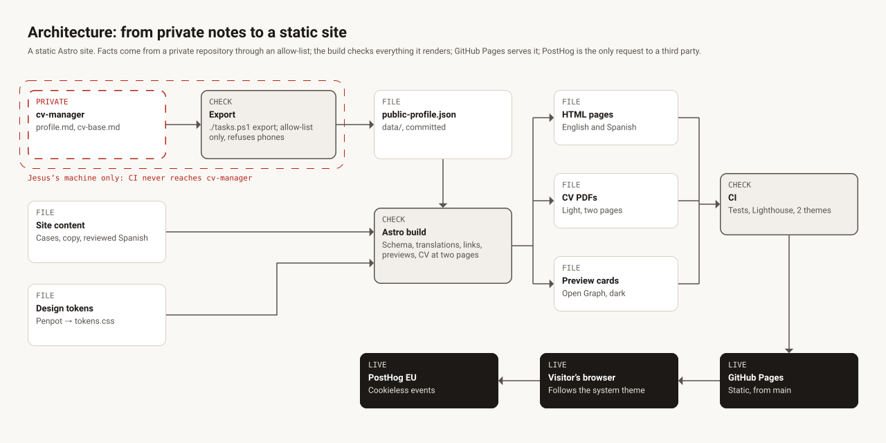

# Architecture



A static Astro site. Nothing runs on a server: every page, the CV and the preview cards are built
ahead of time, and the build fails rather than publish something it cannot check.

## Sources

- **`cv-manager`** is a private repository of Jesus's: his profile and the CV he sends. It is
  read only on his machine; see [Privacy](privacy.md).
- **Site content** in `src/content/`: the case studies, the site's copy and the reviewed Spanish
  translations.
- **Design tokens** in `src/styles/tokens.css`, mirrored from the Penpot design file: every
  colour is one `light-dark()` value, so one list serves both themes.

## Build

- **Export.** `./tasks.ps1 export` reads an allow-list from `cv-manager` and writes
  `data/public-profile.json`, which is committed.
- **Astro build.** `npm run build` renders the pages in English and Spanish, then the CV as a PDF
  per language and a preview card per page, and checks:
  - the content schemas;
  - a reviewed Spanish text for every exported English one;
  - internal links;
  - link previews;
  - structured data;
  - a CV of at most two pages.

## Delivery

- **CI** (GitHub Actions) runs the tests and the build, then Lighthouse on every page in the
  light and the dark theme, and deploys `main`.
- **GitHub Pages** serves the static files.

## In the visitor's browser

- The theme follows the system unless the visitor picks one. A few bytes of inline script apply
  a stored choice before the first paint.
- Scripts only enhance: every link, the CV download and the email fallback work without them.
- **PostHog** (EU, cookieless) is the only request beyond the site.

## Where it lives

```
src/content/     case studies and site copy        src/styles/   tokens and type scale
src/pages/       routes, including /cv             src/lib/      profile export, theme, CV, checks
scripts/         export, artefacts, link checks    tests/        Vitest, run in Docker
data/            the exported public profile       docs/         this documentation
```
