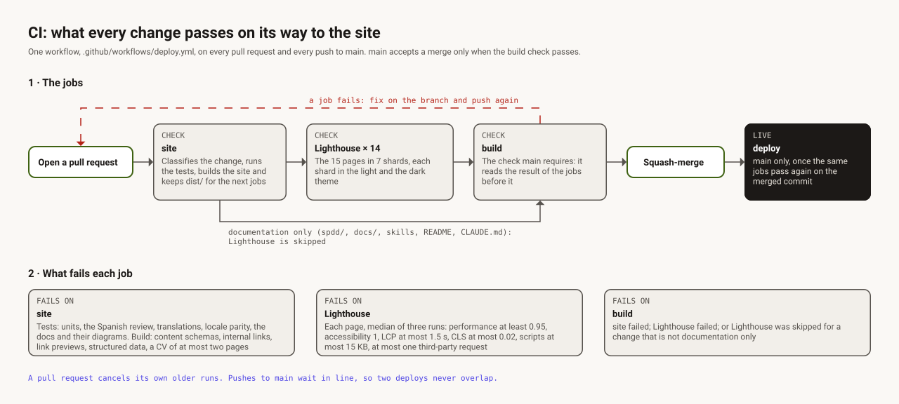

# CI

One workflow, [`.github/workflows/deploy.yml`](../.github/workflows/deploy.yml), runs on every
pull request and every push to `main`. `main` is protected: it accepts a merge only when the
`build` check passes, and that check passes only when every job before it did its part.

## 1 · The jobs

1. **Open a pull request** from a short-lived branch. *Gate: Jesus approves the push.*
2. **`site`.** Classifies the change (`scripts/ci-scope.ts`), runs the tests, builds the site and
   keeps `dist/` for the next jobs.
3. **Lighthouse × 14.** The 15 pages of `lighthouserc.json` in 7 shards, each shard once in the
   light and once in the dark theme. Headless Chrome asks for light, so the dark pass sets the
   preference with a Chrome flag.
4. **`build`.** The check `main` requires. It runs whatever happened before it and reads the
   results: `site` must pass, and Lighthouse must pass, or be skipped for a change that is
   documentation only.
5. **Squash merge.** *Gate: Jesus approves the merge.*
6. **`deploy`.** Only on `main`. The merged commit runs the same jobs again, and GitHub Pages
   serves `dist/` once they pass.

A change made only of documentation (`spdd/`, `docs/`, `.claude/skills/`, `README.md`,
`CLAUDE.md`) never reaches the built site, so it skips Lighthouse; the tests and the build still
run. A failure in any job is fixed on the branch and pushed again.

## 2 · What fails each job

- **`site`:**
  - the tests: the units, the Spanish review, the translations, locale parity, and the
    documentation and its diagrams;
  - the build: content schemas, internal links, link previews, structured data, and a CV of at
    most two pages.
- **Lighthouse,** on each page, as the median of three runs:
  - performance at least 0.95 and accessibility 1;
  - Largest Contentful Paint at most 1.5 s and Cumulative Layout Shift at most 0.02;
  - at most 15 KB of script and one third-party request.
- **`build`:** `site` failed, Lighthouse failed, or Lighthouse was skipped for a change that is
  not documentation only.

## Runs that overlap

A pull request cancels its own older runs, so only its latest push is checked. Pushes to `main`
wait in line instead, so two deploys never overlap.
