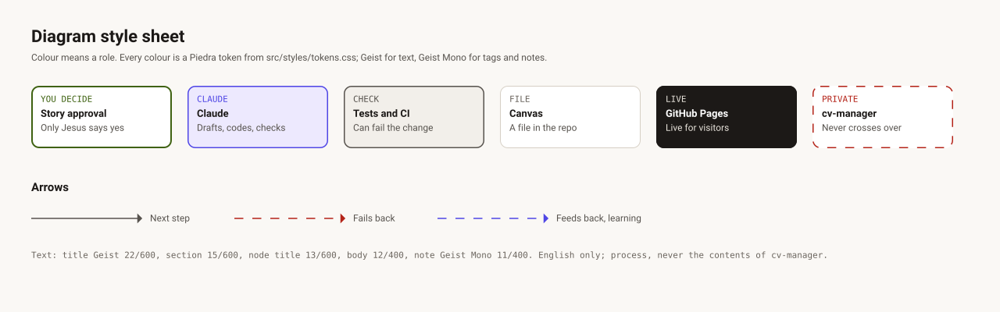

# Design: diagrams and visual language

## Source of truth

The diagrams are designed in the Penpot file **jesusroncal94.github.io · docs**, one page per
diagram and one board per published image. It is a file of its own, separate from the site's
design file, so it stays light. The repository keeps what is published: the SVG export of each
board in [`../diagrams/`](../diagrams/), and a backup of the Penpot file in this folder,
[`jesusroncal94-docs.penpot`](jesusroncal94-docs.penpot), refreshed when the file's structure
changes.

## Manifest

| Penpot page | Board | Published file | Used in | Exported |
|---|---|---|---|---|
| Foundations | style-sheet | [style-sheet.svg](../diagrams/style-sheet.svg) | [Design](README.md) | 2026-10-14 |
| 01 SPDD process | spdd-process | [spdd-process.svg](../diagrams/spdd-process.svg) | [Process](../process.md) | 2026-10-14 |
| 02 Architecture | architecture | [architecture.svg](../diagrams/architecture.svg) | [Architecture](../architecture.md) | 2026-10-14 |
| 03 Privacy boundary | privacy-boundary | [privacy-boundary.svg](../diagrams/privacy-boundary.svg) | [Privacy](../privacy.md) | 2026-10-14 |

`tests/docs.test.ts` keeps this table honest: every SVG has a row and every row an SVG, every
diagram appears on a page, no SVG carries a web font, a script or a remote URL, and every colour
is a token.

## Visual language

Colour means a role, and every colour is a token of the site's light palette (Piedra, in
`src/styles/tokens.css`), so the diagrams look like the site.

| Role | Fill | Stroke | Used for |
|---|---|---|---|
| You decide | `surface` | `signal`, 2 px | A yes only Jesus gives: approvals, pushes, merges |
| Claude | `dusk` | `glow` | The agent: drafts, code, checks it runs |
| Check | `raised` | `muted` | Anything that can fail a change: tests, the build, CI, Lighthouse |
| File | `surface` | `border-strong` | An artefact in the repository |
| Live | `primary` | `primary` | What visitors reach: GitHub Pages, the browser, PostHog |
| Private | `surface` | `before`, dashed | `cv-manager` and the boundary nothing private crosses |

Arrows: `muted` and solid for the next step, `before` and dashed for a failure that sends work
back, `glow` and dashed for feedback. Text is Geist (titles 22/600, sections 15/600, node titles
13/600, body 12/400) and Geist Mono for tags and notes (11/400). Published SVGs fall back to
Segoe UI, Roboto, Helvetica or Arial, and to the system monospace, where Geist is not installed.

## Changing a diagram

The `update-diagram` skill holds the procedure. In short:

1. Connect the Penpot MCP plugin to **jesusroncal94.github.io · docs**, and check the file's name
   before any change. Never edit the site's design file for a diagram.
2. Keep the Penpot tab in front: browsers suspend background tabs and the plugin stops answering.
3. Edit the board using the file's library (the token colours and the five typographies). Review
   it by exporting it to PNG, and fix overlaps and overflowing text.
4. Export the board as SVG, named after the board, and the whole file as `.penpot` when its
   structure changed. The plugin cannot write to disk, so Jesus exports them to Downloads.
5. Copy them into `docs/diagrams/` and this folder, run `./tasks.ps1 diagrams`, update the export
   date above, and run `./tasks.ps1 test`.
6. Change the page that uses the diagram in the same pull request, so text and image agree.

## Rules for content

- English, like the rest of the repository.
- The process and the architecture only: never the contents of `cv-manager`, never a personal
  detail.
