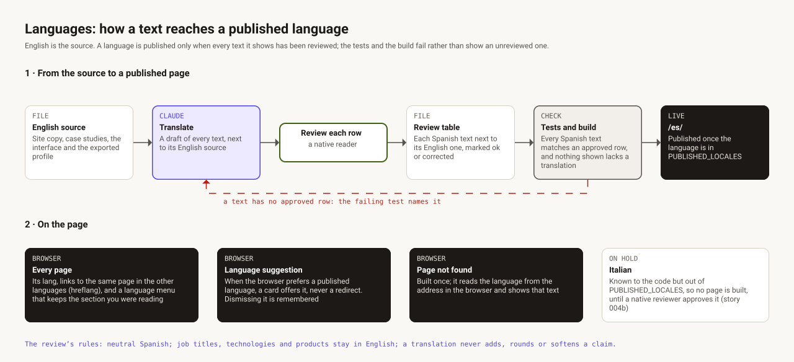

# Languages

The site is written in English and published in English and Spanish. A language is published
only when every text it shows has been reviewed, and the tests and the build fail rather than
show an unreviewed one.

## 1 · From the source to a published page

1. **English source.** The site's copy (`src/content/site/`), the case studies
   (`src/content/cases/`), the interface (`src/i18n/ui/`) and the exported profile.
2. **Translate.** Claude drafts every text, next to its English source.
3. **Review.** Jesus, a native speaker, reads each row and marks it `ok` or corrects it.
   *Gate: only rows marked `ok` ship.*
4. **Review table.** [`spdd/reviews/004a-es.md`](../spdd/reviews/004a-es.md) keeps each Spanish
   text beside its English one, marked `ok` or corrected.
5. **Tests and build.** Every Spanish text must match an approved row; every profile value and
   CV text must have a translation, and none may be left over; each case must exist in both
   languages. A failure names the text, and the translation goes back for review.
6. **Published.** A language is built only once it is in `PUBLISHED_LOCALES`
   (`src/i18n/locales.ts`); Spanish is served under `/es/`.

The review's rules: neutral Spanish for Spain and Latin America; job titles, technologies and
products stay in English; a translation never adds, rounds or softens a claim.

## 2 · On the page

- **Every page** declares its language, links to the same page in the other languages
  (`hreflang`), and has a language menu that keeps the section being read.
- **Language suggestion.** When an English page is opened by a browser that prefers another
  published language, a card offers it. It never redirects, and dismissing it is remembered.
- **Page not found.** One 404 page serves every language: it reads the language from the address
  in the browser and shows that text.
- **Italian** is known to the code but kept out of `PUBLISHED_LOCALES`, so no Italian page is
  built until a native reviewer approves it (story 004b, on hold).
