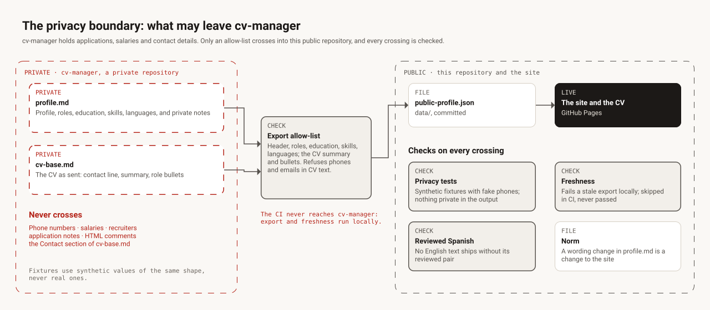

# Privacy

`cv-manager` holds job applications, salaries, recruiters and contact details. This repository
and the site are public. The boundary between them is the part of the system that has caused the
most incidents, so it is drawn, tested and narrow.

## What crosses

The export (`./tasks.ps1 export`, on Jesus's machine only) reads two files and keeps an
allow-list:

- from `profile.md`: the name, headline, city, the public email, LinkedIn and GitHub, the roles,
  education, skills and languages;
- from `cv-base.md`: the summary and the role bullets, word for word, so the site's CV says what
  Jesus sends.

It strips HTML comments first, and refuses any phone number or email address in the CV text.

## What never crosses

Phone numbers, salaries, recruiters, application notes, HTML comments, and the Contact section of
`cv-base.md`. Test fixtures use synthetic values of the same shape, never real ones.

## Checks on every crossing

- **Privacy tests** run the export on synthetic fixtures that contain fake phone numbers and
  private notes, and fail if any of them reaches the output.
- **Freshness.** `./tasks.ps1 test` fails on Jesus's machine when `data/` lags behind
  `cv-manager`. In CI the check is reported as skipped, never as passed.
- **Reviewed Spanish.** No English text from the export ships without its reviewed Spanish pair.
- **Norm.** A change of wording in `profile.md` is a change to the site: every text drawn from
  it is brought in line.

## Why CI never reaches it

`cv-manager` is a private GitHub repository, but this repository's CI has no token for it and
never will: giving it one would put applications and contact details one leaked secret away from
a public repository. The export and the freshness check run locally, by design.
