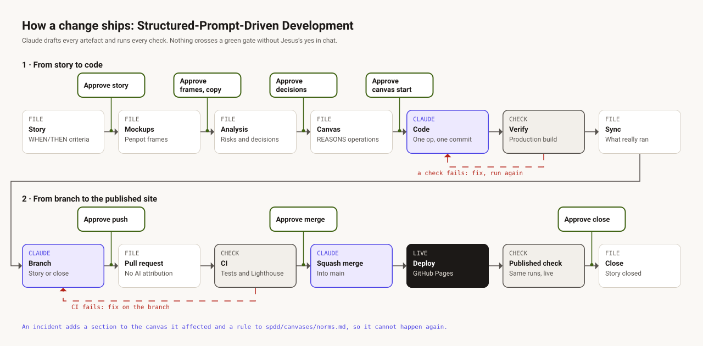

# Process

Every change follows [Structured-Prompt-Driven Development](https://martinfowler.com/articles/structured-prompt-driven/).
Claude drafts each artefact and runs each check; nothing crosses a gate without Jesus's yes in chat.

## 1 · From story to code

1. **Story.** A persona, WHEN/THEN acceptance criteria and a definition of done, in
   `spdd/stories/`. *Gate: Jesus approves the story.*
2. **Mockups.** Frames in Penpot for anything visible, and the user-facing copy.
   *Gate: Jesus approves the frames and the copy.*
3. **Analysis.** Diagnosis, direction, risks, and one recommendation per decision, in
   `spdd/analysis/`. *Gate: Jesus confirms each decision; it is recorded with its date.*
4. **Canvas.** A REASONS canvas in `spdd/canvases/`: requirements, entities, approach,
   structure, operations, norms and safeguards. *Gate: Jesus approves the start.*
5. **Code.** One operation at a time, one commit per operation.
6. **Verify.** On the production build: tests, end-to-end runs in three browsers, overflow at
   twelve widths, screenshots against the frames. A failed check goes back to the code.
7. **Sync.** The canvas gets a Sync section that records what really ran, including what went
   differently; it is authoritative over the operations.

## 2 · From branch to the published site

8. **Branch.** A short-lived branch for the story, and later one to close it.
   *Gate: Jesus approves every push.*
9. **Pull request.** Conventional commits, no AI attribution.
10. **CI.** Tests and the build, then the Lighthouse budget on every page in the light and the
    dark theme. Documentation-only changes skip Lighthouse. A failure is fixed on the branch.
    *Gate: Jesus approves the merge.*
11. **Squash merge** into `main`.
12. **Deploy** to GitHub Pages.
13. **Published check.** The same end-to-end runs, against the live site.
    *Gate: Jesus approves the closing push.*
14. **Close.** A documentation-only pull request records the results in the canvas and closes
    the story.

## When something goes wrong

An incident gets a section in the canvas it affected and a new rule in
[`spdd/canvases/norms.md`](../spdd/canvases/norms.md), so it cannot happen again. A change of
process or architecture updates its page here, and its diagram, in the same pull request.
