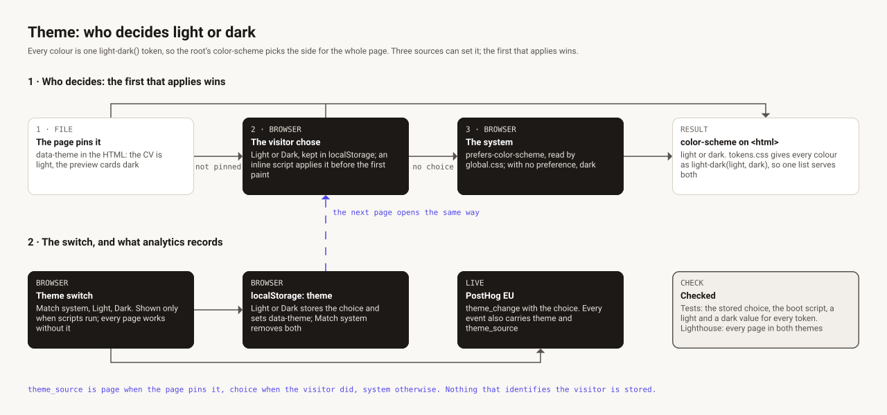

# Theme

The site is light or dark. Every colour in [`src/styles/tokens.css`](../src/styles/tokens.css)
is one `light-dark(light, dark)` value, so the `color-scheme` of the root element picks the side
for the whole page, and one list of colours serves both themes.

## 1 · Who decides

Three sources can set the theme. The first that applies wins.

1. **The page pins it.** A page that must look the same for everyone carries `data-theme` in
   its HTML: the CV is light, like its PDF, and the preview cards are dark. The CV also carries
   `data-theme-pinned`, so analytics can tell its theme from a visitor's choice.
2. **The visitor chose.** A choice of Light or Dark is kept in `localStorage`. A few bytes of
   inline script in `<head>` apply it before the first paint, so a page never flashes the other
   theme.
3. **The system.** Otherwise `global.css` follows `prefers-color-scheme`. A browser with no
   preference gets dark.

## 2 · The switch, and what analytics records

1. **The switch** offers Match system, Light and Dark. It is shown only when scripts run; every
   page works without it.
2. **Light or Dark** stores the choice and sets `data-theme`, so the next page opens the same
   way. **Match system** removes both.
3. **Analytics.** Every event carries `theme`, light or dark as the page was shown, and
   `theme_source`: `page` when the page pins it, `choice` when the visitor chose, `system`
   otherwise. Using the switch sends a `theme_change` event with the choice. Nothing that
   identifies the visitor is stored; see the site's privacy note.
4. **Checks.** Tests cover the stored choice, the boot script and a light and a dark value for
   every token. CI runs Lighthouse on every page in both themes; see [CI](ci.md).

## A trap worth knowing

The scripts on each page are small enough to be inlined into the HTML. If two of them import the
same module, the bundler moves it into a shared file, and that file is one more request before
the largest paint. In story 022 that cost about 10 ms and broke the 1.5 s budget in 10 of the
14 Lighthouse jobs, which is why the analytics reads the theme from the page instead of importing
the theme code.
